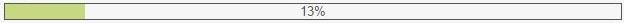
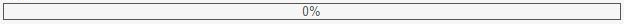

<div id="top"></div>

[![Contributors][contributors-shield]][contributors-url]
[![Forks][forks-shield]][forks-url]
[![Stargazers][stars-shield]][stars-url]
[![Issues][issues-shield]][issues-url]
[![LinkedIn][linkedin-shield]][linkedin-url]

<br />
<div align="center">
  <a href="https://github.com/TasfiqSami/TasfiqUnloader/">
    
  </a>

  <h3 align="center">Tasfiq Unloader</h3>

  <p align="center">
    A lightweight Minecraft plugin that hibernates your server and unloads chunks while nobody is online.
    <br />
    <a href="https://github.com/TasfiqSami/TasfiqUnloader#readme"><strong>Explore the docs »</strong></a>
    <br />
    <br />
    <a href="https://github.com/TasfiqSami/TasfiqUnloader/issues">Report Bug</a>
    ·
    <a href="https://github.com/TasfiqSami/TasfiqUnloader/issues">Request Feature</a>
  </p>
</div>

<details>
  <summary>Table of Contents</summary>
  <ol>
    <li><a href="#about-this-plugin">About This Plugin</a></li>
    <li><a href="#installation">Installation</a></li>
    <li><a href="#configuration">Configuration</a></li>
    <li><a href="#commands--permissions">Commands &amp; Permissions</a></li>
    <li><a href="#caveats">Caveats</a></li>
    <li><a href="#building">Building</a></li>
    <li><a href="#contact">Contact</a></li>
  </ol>
</details>

## About This Plugin

[![Title][product-screenshot]](#about-this-plugin)

TasfiqUnloader reduces CPU usage to about 0-1% while no players are online. When the last player leaves, the plugin saves all worlds and then intentionally "freezes" the server tick loop until someone joins again. While frozen it also unloads loaded chunks, so memory is released too.

*It is only useful for small servers that tend to be empty at night or during school days. If you have 500 players, it will never kick in.*

### Features

* Save electricity (if you host the server yourself)
* Let other software use the CPU when no one is playing
* Run more servers on one machine
* Works on Spigot, Paper and Purpur (Minecraft 1.21+)
* Very lightweight, and has no effect at all while players are online

### Server with no players online


### Server with no players online and TasfiqUnloader installed


> **Paper 1.21.2+ users:** Paper has a built-in `pause-when-empty-seconds` option (see its global config). It does a similar job natively. This plugin remains useful on Spigot, and if you also want the chunk unloading and the blacklist.

<p align="right">(<a href="#top">back to top</a>)</p>

## Installation

Requires **Java 21** or newer and **Minecraft 1.21+** (Spigot, Paper or Purpur). Folia is not supported.

1. Download the latest jar from the [Releases](https://github.com/TasfiqSami/TasfiqUnloader/releases) page.
2. Put it in your `plugins` folder.
3. Restart your server. That's it.

## Configuration

`plugins/TasfiqUnloader/config.yml`:

| Key | Default | Description |
| --- | --- | --- |
| `enabled` | `true` | Whether hibernation is active at startup. |
| `sleepMillis` | `1000` | How long the server sleeps per tick while empty (1-10000). Keep it well below your watchdog timeout. |
| `unloadChunks` | `true` | Unload loaded chunks while nobody is online. |
| `gcAfterUnload` | `true` | Run the garbage collector after chunks were unloaded. |
| `unloadIntervalSeconds` | `30` | Only used when hibernation is disabled by the blacklist: how often chunks are unloaded while empty. |
| `blacklist` | `[]` | Plugin names (case-insensitive) that break while the server is frozen. If any is installed, hibernation stays off and only chunk unloading runs. An entry starting with `http://` or `https://` is downloaded as a list with one plugin name per line (`#` for comments). |

Use `/hibernate reload` to apply changes.

## Commands & Permissions

| Command | Description |
| --- | --- |
| `/hibernate` or `/hibernate toggle` | Turn hibernation off or on again. Not saved over a reload or restart. |
| `/hibernate status` | Show whether the plugin is enabled and whether the server is currently sleeping. |
| `/hibernate reload` | Reload `config.yml`. |

`/tasfiqunloader` works as an alias. All subcommands need the permission `tasfiqunloader.toggle` (OP by default). Toggling is useful when you need to generate a world or run a task while nobody is online.

## Caveats

* The first player to join while the server is hibernating might have to try to connect twice. In most cases this is not needed, but it is possible.
* Since the server is frozen, plugins like Dynmap stop working while nobody is online (for Dynmap an advanced workaround is to use your own web server instead of the built-in one).
* The plugin won't help if your server is never empty.
* "Can't keep up!" messages might show up in your console after hibernation.
* While the server is hibernating, your TPS goes down (intentionally). Plugins that monitor TPS may report issues during hibernation and for a few minutes after, because they use averages of the past X minutes.

<p align="right">(<a href="#top">back to top</a>)</p>

## Building

```sh
mvn package
```

The jar is written to `target/TasfiqUnloader-<version>.jar`. Needs JDK 21+ and Maven.

## Contact

Tasfiq - [Discord](https://discord.gg/kKQd6PJe22) - tasfiq@programmer.net

Project Link: [https://github.com/TasfiqSami/TasfiqUnloader](https://github.com/TasfiqSami/TasfiqUnloader)

<p align="right">(<a href="#top">back to top</a>)</p>

[contributors-shield]: https://img.shields.io/github/contributors/TasfiqSami/TasfiqUnloader.svg?style=for-the-badge
[contributors-url]: https://github.com/TasfiqSami/TasfiqUnloader/graphs/contributors
[forks-shield]: https://img.shields.io/github/forks/TasfiqSami/TasfiqUnloader.svg?style=for-the-badge
[forks-url]: https://github.com/TasfiqSami/TasfiqUnloader/network/members
[stars-shield]: https://img.shields.io/github/stars/TasfiqSami/TasfiqUnloader.svg?style=for-the-badge
[stars-url]: https://github.com/TasfiqSami/TasfiqUnloader/stargazers
[issues-shield]: https://img.shields.io/github/issues/TasfiqSami/TasfiqUnloader.svg?style=for-the-badge
[issues-url]: https://github.com/TasfiqSami/TasfiqUnloader/issues
[linkedin-shield]: https://img.shields.io/badge/-LinkedIn-black.svg?style=for-the-badge&logo=linkedin&colorB=555
[linkedin-url]: https://bio.link/tasfiqah
[product-screenshot]: img/title.jpg
