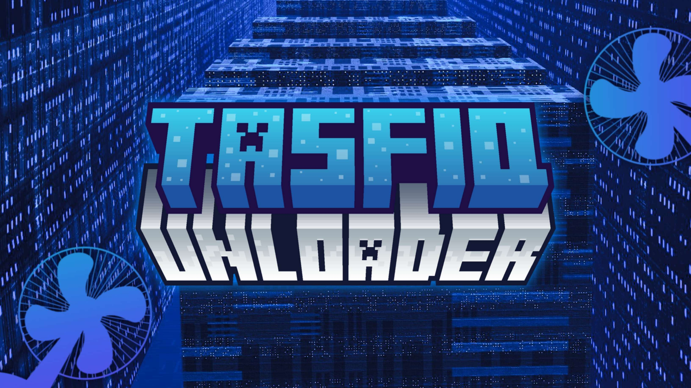
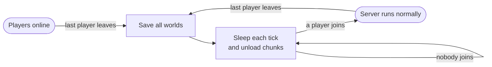

<div align="center">


# TasfiqUnloader

**Your Minecraft server sleeps when nobody is online.**<br>
CPU drops to about 0-1%, memory is released, and everything wakes up the moment a player joins.

[](https://github.com/TasfiqSami/TasfiqUnloader/actions/workflows/ci.yml)
[](https://github.com/TasfiqSami/TasfiqUnloader/releases/latest)
[](https://github.com/TasfiqSami/TasfiqUnloader/releases)
[](#compatibility)
[](#compatibility)
[](LICENSE)

[**Download**](https://github.com/TasfiqSami/TasfiqUnloader/releases/latest) &nbsp;|&nbsp;
[Quick start](#quick-start) &nbsp;|&nbsp;
[How it works](#how-it-works) &nbsp;|&nbsp;
[Configuration](#configuration) &nbsp;|&nbsp;
[FAQ](#faq) &nbsp;|&nbsp;
[Discord](https://discord.gg/kKQd6PJe22)



</div>

---

## Why use it?

Most small servers sit empty for hours (at night, on school days, between sessions) but still burn a CPU core and hold chunks in memory. TasfiqUnloader notices when the last player leaves, saves your worlds, and puts the server to sleep until someone joins again.

|  | Server with no players online | With TasfiqUnloader |
| --- | --- | --- |
| **CPU** |  |  |

Good for:

- saving electricity when you host the server yourself
- letting other software use the CPU while nobody plays
- running more servers on the same machine

> [!NOTE]
> It only helps servers that are regularly empty. If you always have players online, it never kicks in (and costs nothing).

## Quick start

1. Download `TasfiqUnloader-<version>.jar` from the [latest release](https://github.com/TasfiqSami/TasfiqUnloader/releases/latest).
2. Drop it into your server's `plugins` folder.
3. Restart the server.

That's it. The defaults work for most servers. Each release also ships a `.sha256` file to verify the download.

## How it works



While the server is empty, TasfiqUnloader sleeps the main thread a little every tick (`sleepMillis`, 1 second by default). That freezes the game loop, which is why CPU use falls to almost nothing. It also unloads loaded chunks and runs the garbage collector, so memory is given back too. Worlds are saved once before the sleep starts.

Plugins that cannot survive a frozen server (a web map, for example) can be added to a [blacklist](#the-blacklist). If one is installed, the plugin skips the freeze and only unloads chunks on a timer.

## Compatibility

One jar works everywhere. It is compiled as Java 8 bytecode against the Bukkit 1.8.8 API, so it only uses calls that exist on every version.

| | |
| --- | --- |
| **Minecraft** | 1.8 to 26.x |
| **Java** | 8 to 25 |
| **Server software** | Spigot, Paper and forks (Purpur and similar), CraftBukkit |
| **Not supported** | Folia |

Run the Java version your server software asks for. Typical choices:

| Minecraft | Usual Java |
| --- | --- |
| 1.8 to 1.16 | 8 (newer also works for most of these) |
| 1.17 | 16 or 17 |
| 1.18 to 1.20.4 | 17 |
| 1.20.5 to 1.21.x | 21 |
| 26.x | 25 |

The plugin itself runs on all of them. Check your server software's documentation for its exact requirement.

How this is checked:

- CI rejects any class that is not Java 8 bytecode.
- CI loads and verifies the jar on JDK 8, 11, 17, 21 and 25.
- A manual workflow boots real Paper servers from 1.8.8 to the latest release with the plugin installed.

> [!TIP]
> **Paper 1.21.2+** has a built-in `pause-when-empty-seconds` option that does a similar job. TasfiqUnloader is still the choice for every other version, and when you also want chunk unloading and the blacklist.

## Commands and permissions

| Command | What it does |
| --- | --- |
| `/hibernate` or `/hibernate toggle` | Turn hibernation off or on. Not saved over a reload or restart. |
| `/hibernate status` | Show whether the plugin is enabled and whether the server is sleeping right now. |
| `/hibernate reload` | Reload `config.yml`. |

`/tasfiqunloader` works as an alias. Every subcommand needs the permission `tasfiqunloader.toggle` (OP by default).

Toggling is handy when you need the server awake with nobody online, for example to generate a world or run a long task.

## Configuration

`plugins/TasfiqUnloader/config.yml`:

```yaml
enabled: true               # hibernation active at startup
sleepMillis: 1000           # sleep per tick while empty (1-10000)
unloadChunks: true          # unload loaded chunks while empty
gcAfterUnload: true         # run the garbage collector after unloading
unloadIntervalSeconds: 30   # chunk unload interval when the blacklist disables hibernation
blacklist: []               # plugins that break while the server is frozen
```

| Key | Default | Description |
| --- | --- | --- |
| `enabled` | `true` | Whether hibernation is active at startup. |
| `sleepMillis` | `1000` | How long the server sleeps per tick while empty, from 1 to 10000. Keep it well below your server's watchdog timeout. |
| `unloadChunks` | `true` | Unload loaded chunks while nobody is online. |
| `gcAfterUnload` | `true` | Run the garbage collector after chunks were unloaded. |
| `unloadIntervalSeconds` | `30` | Only used when the blacklist disables hibernation: how often chunks are unloaded while empty. |
| `blacklist` | `[]` | Plugin names (case-insensitive) that break while the server is frozen. |

Run `/hibernate reload` to apply changes.

### The blacklist

Some plugins stop working while the server is frozen. Dynmap is the classic example, because its built-in web server goes quiet. List such plugins and TasfiqUnloader backs off:

```yaml
blacklist:
  - Dynmap
  - https://example.com/my-plugin-blacklist.txt   # a URL works too
```

- If any blacklisted plugin is installed, the server is **not** frozen. Chunks are still unloaded every `unloadIntervalSeconds` while it is empty (if `unloadChunks` is on).
- An entry starting with `http://` or `https://` is downloaded once on startup or reload and read as one plugin name per line (`#` starts a comment). It is plain text and never executed. Only use URLs you trust.

## FAQ

<details>
<summary><b>Will players be kicked or lose progress?</b></summary>

No. Hibernation only happens when nobody is online, and worlds are saved before it starts.
</details>

<details>
<summary><b>The first player who joins can't connect. Why?</b></summary>

The server needs a moment to wake up. In most cases it connects on the first try, but sometimes the first player has to try twice.
</details>

<details>
<summary><b>Why do my TPS and "Can't keep up!" warnings look bad?</b></summary>

The slowdown is intentional. TPS drops while the server sleeps, and plugins that average TPS over several minutes may report problems for a while after waking up. It does not affect gameplay.
</details>

<details>
<summary><b>Do scheduled tasks and other plugins keep running while it sleeps?</b></summary>

No. The whole server is frozen, so anything that relies on the game loop (timers, schedulers, web maps, backups started by a plugin) pauses until a player joins. Use the [blacklist](#the-blacklist) for plugins that must keep running, or `/hibernate toggle` for one-off jobs.
</details>

<details>
<summary><b>Does it work on Folia?</b></summary>

No. Folia's regionized threading cannot be frozen this way, and the plugin does not declare Folia support.
</details>

<details>
<summary><b>Does it work with Paper's <code>pause-when-empty-seconds</code>?</summary>

You can use either. On Paper 1.21.2 and newer the built-in option does a similar job. TasfiqUnloader is for other versions and for when you also want chunk unloading and the blacklist.
</details>

<details>
<summary><b>Will it work on my version?</b></summary>

Almost certainly, anything from 1.8 to 26.x on Java 8 to 25. See [Compatibility](#compatibility). If it doesn't, please [open an issue](https://github.com/TasfiqSami/TasfiqUnloader/issues/new/choose) with your server version and log.
</details>

## Building from source

You need JDK 17 or newer and Maven. The code is compiled for Java 8 (`--release 8`).

```sh
git clone https://github.com/TasfiqSami/TasfiqUnloader.git
cd TasfiqUnloader
mvn package
```

The jar is written to `target/TasfiqUnloader-<version>.jar`.

<details>
<summary><b>Use it as a Maven dependency</b></summary>

Releases are also published to GitHub Packages (GitHub requires a token with `read:packages` to download from it):

```xml
<repositories>
  <repository>
    <id>github</id>
    <url>https://maven.pkg.github.com/TasfiqSami/TasfiqUnloader</url>
  </repository>
</repositories>

<dependency>
  <groupId>io.github.tasfiqsami</groupId>
  <artifactId>tasfiqunloader</artifactId>
  <version>3.0.1</version>
  <scope>provided</scope>
</dependency>
```
</details>

## Releases

Releases are built by GitHub Actions. To publish one:

1. Bump the version in `pom.xml`, add a section for it to [`CHANGELOG.md`](CHANGELOG.md), and merge to `main`.
2. Open **Actions > Release > Run workflow**. It creates the tag `v<version>` and the GitHub release (with the changelog section as notes), builds the jar, confirms it is Java 8 bytecode, attaches the jar and its checksum, and publishes the package.

Prefer to do it by hand? Publish a GitHub release whose tag is `v` plus the pom version (**Releases > Draft a new release**, or `gh release create v3.0.1 --notes-file notes.md`). The same workflow then runs, checks that the tag matches the pom, and attaches the files.

Run the [Server compatibility workflow](.github/workflows/compat.yml) from the Actions tab before a release to boot real servers with the new jar.

## Contributing

Contributions are welcome. Start with [CONTRIBUTING.md](CONTRIBUTING.md) for the setup and the compatibility rules (Java 8 bytecode, Bukkit 1.8.8 API only), and follow the [Code of Conduct](CODE_OF_CONDUCT.md).

| I want to... | Go to |
| --- | --- |
| Ask a question | [Discord](https://discord.gg/kKQd6PJe22) or [SUPPORT](.github/SUPPORT.md) |
| Report a bug or request a feature | [Issues](https://github.com/TasfiqSami/TasfiqUnloader/issues/new/choose) |
| Report a security problem | [SECURITY.md](SECURITY.md) |
| See what changed | [CHANGELOG.md](CHANGELOG.md) |

## License

Released under the [MIT License](LICENSE).

## Contact

Made by **Tasfiq** &nbsp;|&nbsp; [Discord](https://discord.gg/kKQd6PJe22) &nbsp;|&nbsp; [tasfiq@programmer.net](mailto:tasfiq@programmer.net) &nbsp;|&nbsp; [LinkedIn](https://bio.link/tasfiqah)

<div align="right"><a href="#tasfiqunloader">Back to top</a></div>
